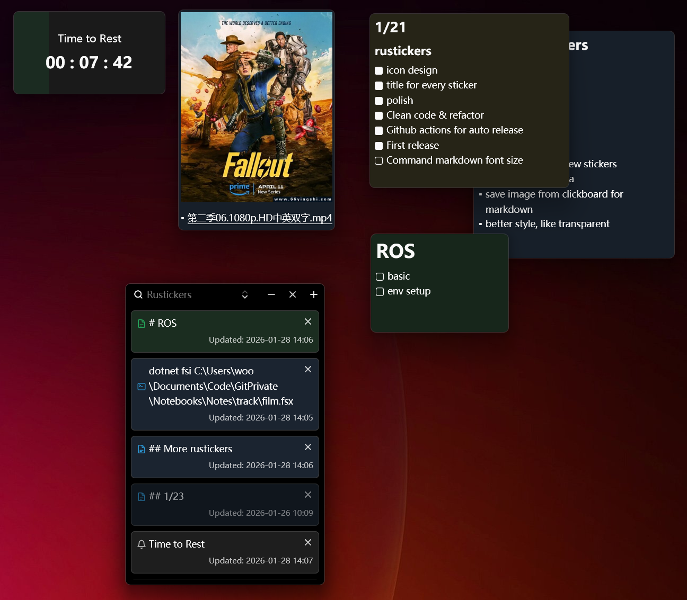

# Rustickers

A lightweight desktop sticker app for notes, timers, command output, and file previews.

Built with [GPUI Kit 0.7.1](https://crates.io/crates/gpui-kit), powered by local SQLite, and designed to stay fast and simple.



## Highlights

- **Markdown notes**: quick editing, preview mode, and **Ctrl+S** save.
- **Timers**: countdown timers with an audible alert on completion.
- **Command stickers**: pin command output, with optional cron scheduling, env vars, and working directory. A scheduled sticker keeps running in the background even when its window is closed; the manager shows which stickers are running or waiting for their next tick.
- **File / URL preview**: preview files, folders, or URLs and pin them as stickers. Any number of previews can be open side by side; asking for the same files again raises the window that already shows them.
- **Paint stickers**: freehand drawing space for quick sketches.

All chrome uses the kit theme — there are no raw colour literals in chrome paths. See [`FRONTEND.md`](./FRONTEND.md) for the contributor-side conventions.

## Clipboard history

A keyboard-first history chooser shares exact-text deduplication, search, ordering, and
SQLite storage with the CLI. Ordinary history is bounded by count and bytes; reserved,
edited, and protected items are retained independently. Collection starts **paused** so
copying a password does not silently opt you into recording it.

```bash
rst cp ls                              # browse: type, ↑/↓, Enter, Esc
rst cp ls -s rust                       # start with a filter
rst cp ls --list -n 20                  # readable recent-history table
rst cp ls --list --json                 # one machine-readable JSON object
rst cp ls -- rg -F -- '{{cp}}' .         # pick and substitute into argv
rst cp ls --id 42 -- my-tool            # append the exact text as one argument
rst cp add 'text from a script'
rst cp add --stdin                      # read a pipeline without trimming it
rst cp show --id 42                     # exact text, no extra newline
rst cp rm 42                            # release ordinary saved/edit retention
rst cp add --protect --stdin            # authorize, encrypt, then store piped text
rst vault create                        # choose a master password (hidden prompts)
rst vault unlock                        # verify it for one command run
rst vault status                        # does a vault exist; how CLI authorization works
```

Quote `'{{cp}}'` in PowerShell/POSIX shells, or `"{{cp}}"` in Windows cmd. The CLI
uses the parsed argument vector directly: spaces, quotes, newlines, and shell punctuation
remain data. Child stdin/stdout/stderr are inherited unchanged; chooser/password prompts
use the controlling terminal. Cancellation returns 130; missing/non-executable programs
return 127/126; otherwise the child exit code propagates. Use child-supported `--` to
prevent clipboard text beginning with `-` from becoming an option. **Explicitly passing
clipboard text into a shell/interpreter's code argument can still execute it.**

Open/dismiss the desktop chooser with `Ctrl + Alt + V` (`Cmd + Alt + V` on macOS).
Type to search, use arrows/Page keys to select, and press Enter to paste; Ctrl/Cmd+Enter
copies only. Single-click selects, F2/double-click edits, and Ctrl/Cmd+R toggles reservation.
Ctrl/Cmd+L protects the selected item after password authorization; encrypted edits are saved
in place. The chooser uses the existing theme and a virtualized list, with visible actions,
and confirms irreversible deletes (pinned, edited, or protected rows) before applying them.
Verified automatic paste is currently Windows-only; unavailable or lost destinations fail
closed and leave **Copy only** available.

Protected adds are encrypted before insertion and never fall back to ordinary history.
Protected text is not searchable; only an explicitly public alias is visible. The master
password is managed in the desktop app or with `rst vault`; CLI password authorization is
scoped to that invocation, **not shared with the desktop process**, and `rst vault unlock`
verifies a password rather than unlocking subsequent commands. Automatic
collection pauses whenever protected history exists until safe protected recapture matching
is implemented.

> Encryption does not erase copies held by other apps, the OS clipboard history, backups,
> or pre-encryption database artifacts. Vault grace periods, audit trails, and rotation
> are still tracked as hardening work.

## Global hotkeys

- **Show main window**: `Ctrl + Alt + R` (`Cmd + Alt + R` on macOS)
- **Toggle clipboard chooser**: `Ctrl + Alt + V` (`Cmd + Alt + V` on macOS) — pastes back into the previously focused app
- **Toggle quick file preview**: `Ctrl + Alt` (modifier-only chord)
- **Open command for selected text**: `Ctrl/Cmd + Space` (consumed; not forwarded to the active app)
- **Dismiss transient Rustickers windows**: `Esc` is consumed for selection popups, quick previews, the clipboard chooser, and selected-text command runs
- **Save in editor/markdown views**: `Ctrl + S`

## Quick start

Prerequisite: stable Rust toolchain.

```bash
cargo run                                    # desktop app
cargo run --bin rst --no-default-features --features cli -- --help
cargo build --release --bin rustickers
cargo build --release --bin rst --no-default-features --features cli
```

Outputs are written to `target/release/`.

## CLI commands

`rst` is the scripting surface for the app. It writes to the same database the app reads, so
changes apply immediately when the app is running and on next launch when it is not.

| Command | What it does |
| --- | --- |
| `list [--state open\|close\|all] [--type <t>] [-s <text>] [-n <limit>]` | Find stickers |
| `show <id> [--content-only]` | Everything stored about one sticker |
| `result <id>` | What a command sticker last produced |
| `open <id>` / `close <id>` | Show or hide a sticker's window |
| `delete <id> [-y]` | Remove a sticker permanently |
| `view <path-or-url>` | Preview a file, folder or URL |
| `markdown [-c <text>] [-f <file>]` | Create a note sticker |
| `cmd <command> [...]` | Create a command sticker |
| `skill [list\|show <name>\|run <name>]` | Worked examples |

All of them accept the shared appearance options `--width`, `--height`, `--left`, `--top`,
`--color` (yellow, green, blue, pink, gray), `--top-most` and `--closed`. Markdown and command
stickers default to 400×300; file and URL stickers are sized from their content.

Passing a single file path or URL is treated as `view <source>` automatically, and trailing
options are forwarded.

### Command stickers

```bash
rst cmd "cargo test" --result text --dir .          # run and show plain output
rst cmd "npm test 2>&1 | tail -20" --shell          # use a shell for pipes and redirection
rst cmd "gh pr list" --cron "0 */5 * * *"         # re-run every five minutes
rst cmd "copilot -p {{RUSTICKERS_SELECTION}}" \
  --accept-selection --result markdown --closed           # answer whatever text you have selected
```

`--result` controls how the captured output is rendered: `text`, `markdown`, `html`
(an embedded browser view), `svg` (an image), or `source` (the output is one file path or
URL to preview). Other useful flags are `--stream`, `--no-window`, `--auto-close`,
`--padding`, `--env KEY=VALUE` and `--idle`.

Two things are worth knowing. A command sticker does **not** run through a shell by default:
the string is split with Windows argument rules and the program is looked up on `PATH`,
so pipes and `&&` are literal text until you add `--shell`. A sticker created without
`--idle` is *armed*, meaning it runs when its window opens and again each time the app starts.

An armed sticker with `--cron` also keeps running with its window **closed**, for as long
as the app is running. Combine it with `--no-window` for a schedule that never puts
anything on screen, and read the result over `rst result <id>` from anywhere.
In the manager, a spinner marks a command that is running right now and a loop icon marks
one waiting for its next tick. Press Stop on the sticker to disarm it, or delete the
sticker to stop it for good.

### Machine-readable output

Add `--json` to any command to get exactly one JSON object on stdout, with an `ok` field so
success and failure parse the same way:

```bash
rst cmd "git status --short" --dir . --json   # → {"ok":true,"id":42,...}
rst result 42 --json                          # → {"ok":true,"output":"...","has_run":true}
```

### Skills

`rst skill list` is a catalogue of ready-made stickers — selection-driven AI prompts,
scheduled watchers, HTML and SVG reports. `skill show <name>` explains one and prints the
exact `rst` command it is equivalent to, and `skill run <name> --var key=value` creates
it. `--dry-run` prints the command without creating anything.

## Data and logs

Rustickers stores data in `stickers.db` under your app data directory and writes daily-rotated logs to a sibling `logs/` directory.

Typical locations:

- **Windows**: `%LOCALAPPDATA%\rustickers\data\stickers.db` and `%LOCALAPPDATA%\rustickers\data\logs\`
- **macOS**: `~/Library/Application Support/rustickers/data/stickers.db` and `~/Library/Application Support/rustickers/data/logs/`
- **Linux**: `~/.local/share/rustickers/data/stickers.db` and `~/.local/share/rustickers/data/logs/`

Log level precedence:

1. `RUSTICKERS_LOG`
2. `RUST_LOG`
3. fallback: `trace` (debug) / `info` (release)

## Testing gates

```bash
cargo fmt          --all -- --check
cargo check        --locked --features ui
cargo clippy       --locked --features ui
cargo test         --locked --features cli          # 213 passed, 1 ignored
```

CI also runs the same gates across Windows, Ubuntu, and macOS, plus a parity check that
the closure contains exactly one `gpui-pre` family.

## Project layout

```
ARCHITECTURE.md    system architecture, store/IPC contracts
FRONTEND.md        contributor handbook (kit tokens, spawn rules, palette)
src/               crate source
tests/             integration tests (clipboard_storage, sticker_palette)
examples/          visual smoke harnesses
.github/workflows/ CI: fmt, clippy, multi-feature cargo check/test, multi-OS build
```

For the desktop framework, theme, and event-loop rules, see
[`FRONTEND.md`](./FRONTEND.md). For overall system architecture and storage
contracts, see [`ARCHITECTURE.md`](./ARCHITECTURE.md).

## Releases

Tagging (for example `v0.1.0`) triggers GitHub Actions release artifacts for Windows and macOS (UI + CLI bundles).
